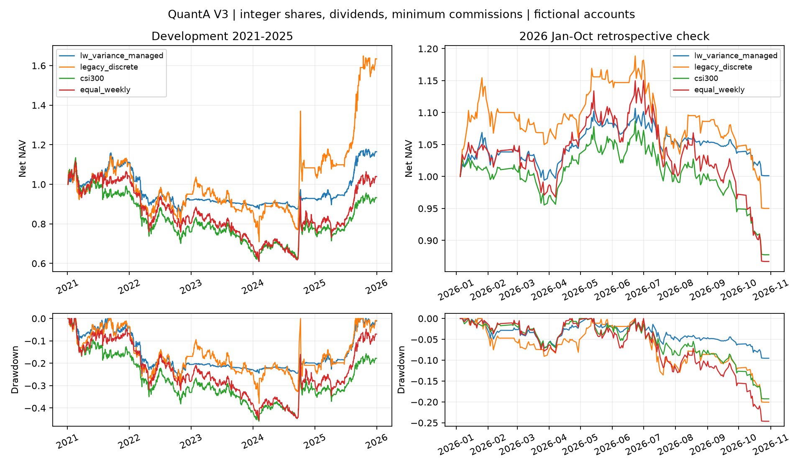

## V3：论文指导的风险与成交改进，尚未发现可靠新α

检索并审查8篇相关论文，加入连续凸组合优化、Ledoit-Wolf协方差收缩、固定均值收缩、成本惩罚、部分调仓和保守逆方差缩放；保留等权与旧式匹配控制。文献也包含波动管理效果不稳定的反面证据。

[文献取舍](docs/V3_LITERATURE.md) · [冻结协议](docs/V3_PROTOCOL.md) · [完整结果](reports/v3/REPORT.md) · [消融与诊断](reports/v3/DIAGNOSTICS.md)

V3按原始报价与分红/拆分事件递推输入，增加登记权益、应收股息、支付日、整手、最低佣金、滞后一日定量订单、容量与价格档位。报价历史版本和精确公告时间仍未认证，不能称为完整PIT数据或真实撮合。

2026-01-01至2026-10-30，虚拟100万元、佣金2bp/最低5元、滑点3bp并向不利价格档位取整：

| 同一预测与账本 | 累计收益 | 净夏普 | 最大回撤 | 年换手 |
|---|---:|---:|---:|---:|
| 预封存方差管理方案 | +0.13% | 0.073 | −9.53% | 13.6 |
| V2式匹配离散控制 | −4.99% | −0.237 | −20.06% | 35.7 |

**预设检验未通过**：三项超额收益区间仍跨零；2026预测R²为−0.076。改善主要表现为风险和换手降低，不能据此声称稳定α。此期为新增回顾性检查，公司行动和少量公开报价信息此前可见，不是前瞻盲测。现金与无风险收益取0。



正式源提交：[a740f45](https://github.com/4v01/QuantA/commit/a740f453764e317fc0b6a592d84ed0206b56a328)；新行情下载前封存：[1864b74](https://github.com/4v01/QuantA/commit/1864b74e5b67c2cfb5d132fe0fc4d766c25ca73f)。

## 审计与复现

6个最终Ridge预测拟合、18个预测候选、342条政策验证路径，396个账本场景全部保留。12个检查点、114条选中预测器的验证账本和396条场景账本可重放。公开日收益可以重算462行统计；原始价格、逐单价格与本地参数不上传公开Git。

```bash
python -m pip install -e . pytest
python -m pytest -q
python -m alphacontextlab.v3.audit
# 以下需要归档data/和outputs/：
python -m alphacontextlab.v3.audit --local-replay
```

[复现指南](docs/V3_REPRODUCE.md)解释公开算术审计、缓存重放、冻结源复训与新数据版本边界。35项协议/账本/证据保护测试通过；V1/V2归档195个文件保持原样。

年度折资金独立重置，全部方法在窗口结束前5个持有区间计划退出，仍计算完整日历。拼接年化不是实际连续账户业绩，2026也不是全年。真实盘口、公告时点档案和更广资产域仍需后续验证。

## 历史版本保持原样

- **V2**：[报告](reports/v2/REPORT.md)、[诊断](reports/v2/DIAGNOSTICS.md)、[协议](docs/V2_PROTOCOL.md)。有界因子演化、研究记忆及X式多目标排序；验证冠军仍为Ridge。2025净夏普2.160，但确认未通过。V3变更了输入/收益权益定义和交易账本，不能把新旧曲线直接拼接成改善。
- **V1**：[报告](reports/v1/REPORT.md)、[诊断](reports/v1/DIAGNOSTICS.md)、[协议](PROTOCOL.md)。LSTM平均净夏普−0.351，Engram式记忆−0.905，未支持记忆增益。

V2参考 [CogAlpha](https://arxiv.org/abs/2511.18850v4)、[XALPHA](https://arxiv.org/abs/2607.08332v3)与[X公开代码](https://github.com/xai-org/x-algorithm/tree/3b6919f87532e57063bb3f1e85c2f509323b513e)的研究/候选/打分/过滤思路；V1参考[DeepSeek Engram](https://github.com/deepseek-ai/Engram/tree/fb7f84a21f91223715394a33a1dc24bbfb7f788e)。均为小规模独立适配，没有复现完整LLM/代理/生产系统，未使用缺失的Level-2或社交数据。
