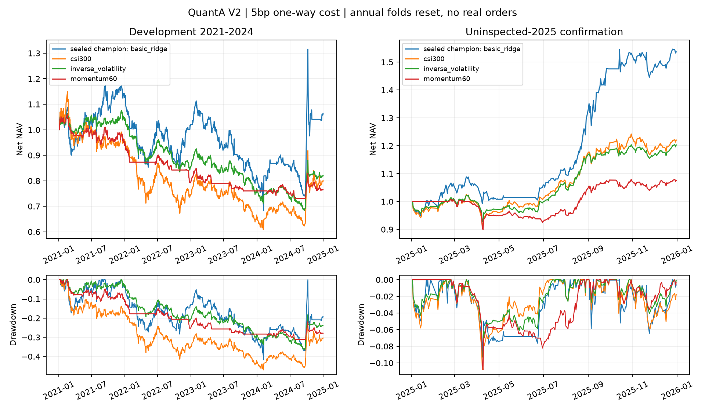

# QuantA

[QuantA](https://github.com/4v01/QuantA) 是独立于 RecRankLab 的A股日频量化研究仓库，研究模块名AlphaContextLab。固定研究4只境内股票ETF，没有券商或实盘下单接口。全部实验记录代码提交、数据版本、候选、配置和随机种子；失败结果不删除。

## V2：收益有改善，预设确认尚未通过

借鉴 [CogAlpha](https://arxiv.org/abs/2511.18850v4) 的有界因子演化、[XALPHA](https://arxiv.org/abs/2607.08332v3) 的研究记忆，以及 [X公开代码](https://github.com/xai-org/x-algorithm/tree/3b6919f87532e57063bb3f1e85c2f509323b513e) 的候选/多目标打分/过滤流程。缺少Level-2数据，未实施MicroTSM；没有复现这些系统的完整LLM、代理或生产架构。

35次最终拟合、85次候选拟合，比较基础/静态因子/演化因子Ridge、双头HGB、3种子的双头LSTM。按验证成本后效用选出的冠军是**基础Ridge**。相同预测下匹配对照每日/每周调仓、风险与成本感知，不能把全部改善归功于新因子或更大网络。

| 预封存冠军，单边5bp | 净夏普 | 年化收益 | 最大回撤 | 年换手 |
|---|---:|---:|---:|---:|
| 2021–2024开发回测 | 0.194 | 1.65% | −41.76% | 40.7 |
| 封存后才下载的2025回顾性留出 | 2.160 | 56.46% | −8.82% | 42.7 |

**预设确认未通过**：相对沪深300的超额均值区块区间仍跨零。2025点估计较好，不等于确认稳定α或实盘可用。仅四只存续ETF、现行复权及连续名义成交近似等限制仍在。

[完整报告](reports/v2/REPORT.md) · [全部消融与诊断](reports/v2/DIAGNOSTICS.md) · [逐模型预测RMSE/R²](reports/v2/forecast_metrics.json) · [冻结协议](docs/V2_PROTOCOL.md) · [来源与迁移边界](docs/V2_RESEARCH.md)



正式源提交：[4bee734](https://github.com/4v01/QuantA/commit/4bee73444c84eb900bc913b99d5da999d3eb0075)；下载2025前公开封存：[acf1d2b](https://github.com/4v01/QuantA/commit/acf1d2b2ebc8a7f8b6f8fce56f03500f1537c621)。开发缓存历史前缀与确认新快照逐项相同，见[获取顺序审计](reports/v2/acquisition_audit.json)。

## 审计与复现

Python 3.11+，CPU。原始行情和模型参数不会上传公开Git；公开日收益足以重算指标。完整源与数据哈希、35个最终拟合的全部候选和因子池在reports/v2/evidence/；局部检查点文件只保留参数和衍生统计。

```bash
python -m pip install -e . pytest
python -m pytest -q
python -m alphacontextlab.audit
python -m alphacontextlab.v2.audit
# 以下需要本地复现快照：
python -m alphacontextlab.v2.audit --local-replay
python -m alphacontextlab.v2.audit --retrain-one
```

22项协议测试；V2的70个验证/最终检查点可重放，888行全部成本/消融统计可由公开日收益重算，1个固定LSTM同环境重训参数逐位一致。新训练必须在干净、独立工作树中运行，见[复现指南](docs/V2_REPRODUCE.md)。重新下载若数据指纹不同，应作为新版本，不能冒充原始版本。

## V1保留原样

V1研究单日收益、LSTM与DeepSeek Engram式记忆，40次最终拟合、84次候选拟合。5bp下普通LSTM三种子平均净夏普−0.351，记忆模型−0.905，没有支持记忆模块优势。

[V1报告](reports/v1/REPORT.md) · [V1诊断](reports/v1/DIAGNOSTICS.md) · [V1协议](PROTOCOL.md) · [V1配置](configs/study.json) · [V1交付记录](DELIVERY.md)。V1正式源提交为`1fa055ba5a44808b74605ae7664636fa31a7bd3a`，归档未重新生成。V2的10日预测R²不能直接和V1单日预测R²比较。

V1参考 [DeepSeek官方Engram](https://github.com/deepseek-ai/Engram/tree/fb7f84a21f91223715394a33a1dc24bbfb7f788e) 的确定性查表及门控思路，独立实现小规模二/三元历史状态记忆；没有下载大模型权重。团队背景、语言模型效果和金融α之间没有可直接推导的关系。
