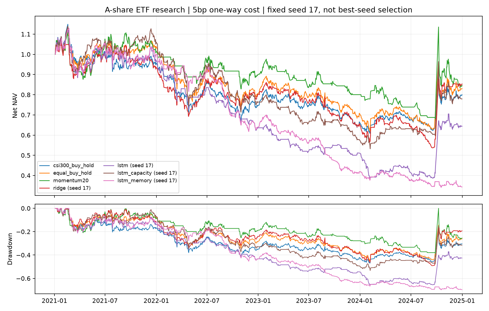

# QuantA

QuantA 的首个研究模块为 AlphaContextLab。

独立于 RecRankLab 的 **A 股日频量化研究项目**。首版研究四只境内股票 ETF；没有实盘或下单接口。

目标是检验 LSTM 与 DeepSeek Engram 式条件记忆是否提供可靠的样本外预测及成本后收益改善，不预设其拥有正 α。

**首版已完成：40次最终拟合、84次候选拟合。结果没有支持记忆模块的收益优势。** 5bp单边费用下，普通LSTM三种子平均净夏普−0.351，记忆模型−0.905；完整负面结果见[实验报告](reports/v1/REPORT.md)、[消融与诊断](reports/v1/DIAGNOSTICS.md)、[交付说明](DELIVERY.md)。



## 研究范围

- 固定篮子：510300（沪深300）、510050（上证50）、510500（中证500）、159915（创业板）。它们都是今天仍然存在、由研究者事先选定的 ETF；不宣称无存续偏差或全市场选股。
- 2014–2024 年日线；2021–2024 年逐年测试，上一年验证，更早数据扩展窗口训练。边界清除跨分区持有期标签；20 日输入历史可以来自分区之前。
- 收盘后特征预测下一开盘至再下一开盘收益；下一开盘才允许调仓。长仓、无杠杆，每日一次调仓，T+1；预测最高且大于零时持有一只 ETF，否则持币。
- 线性 ridge、LSTM、小幅容量匹配的 LSTM、LSTM＋小型条件记忆；另有现金、沪深300 ETF 买入持有、四 ETF 等权买入持有、20 日动量。
- 主假设为成交额单边成本5bp，另报告0/10/20bp；收益、夏普、CAPM α、HAC 区间、回撤、换手、预测 RMSE/R²。无风险及现金收益取零并明确标识。

## 复现

Python 3.11+，CPU；训练使用两个线程。锁定的实际运行依赖见 `requirements-lock.txt`。

```bash
python -m pip install -e . pytest
python -m pytest -q
python -m alphacontextlab.audit
# 以下重放需要本地复现快照中的 data/ 与 outputs/：
python -m alphacontextlab.verify_local --retrain-one

# 新训练使用新输出及报告目录，保留已发表证据。
python -m alphacontextlab.study fetch
# 所有代码、配置须先提交，正式训练拒绝脏工作树。
python -m alphacontextlab.study run --outputs outputs/reproduction
python -m alphacontextlab.study report --outputs outputs/reproduction --reports reports/reproduction
python -m alphacontextlab.verify_local --outputs outputs/reproduction --retrain-one
python -m alphacontextlab.audit --reports reports/reproduction
# 可选的诊断图需要 matplotlib；诊断不重新选择模型。
python -m alphacontextlab.diagnostics --outputs outputs/reproduction --reports reports/reproduction
```

完整候选与预算见 [configs/study.json](configs/study.json)，事前协议见 [PROTOCOL.md](PROTOCOL.md)。有公告依据的已知停牌保留在组合日历中，以过去收盘估值并阻断买卖；相关无开盘成交标签不用于预测误差。数据原始响应、本地参数和单笔预测不上传 Git；报告记录数据、配置、代码和模型指纹。上游历史复权会修订，重新下载若指纹不同必须作为新版本，不能冒充逐位复现。

原正式训练提交为 `1fa055ba5a44808b74605ae7664636fa31a7bd3a`，其后只补交付、审计和报告目录保护逻辑。精确复训原版本应在独立工作树检出该提交，并使用本地快照行情；上述新训练命令会记录当前提交，不冒充原始提交。只验证公开报告不需要下载行情或参数。

## DeepSeek 方法来源

参考 [DeepSeek 官方 Engram](https://github.com/deepseek-ai/Engram/tree/fb7f84a21f91223715394a33a1dc24bbfb7f788e)：确定性多头 n-gram 查表、由当前隐藏状态控制融合。这里用训练集量化后的收益/波动状态代替文本 token，在最后一个历史状态上融合二/三元模式记忆；代码为本项目独立实现，没有下载 LLM 权重，也没有复制完整 Engram/DeepSeek 网络。官方公开代码本身是演示实现。不能从语言模型实验或团队背景推导金融收益。

## 解释边界

当前前复权第三方日线不是逐时点数据档案；连续名义仓位模拟未实现整手、最低佣金、盘口冲击和实际集合竞价撮合。涨跌停按开盘相对前收的复权比值近似保守过滤。固定存续 ETF 的回顾性结果只适合方法筛选；正 α 若出现，仍需多重检验控制、独立时期、逐时点数据与更真实交易模拟确认。
