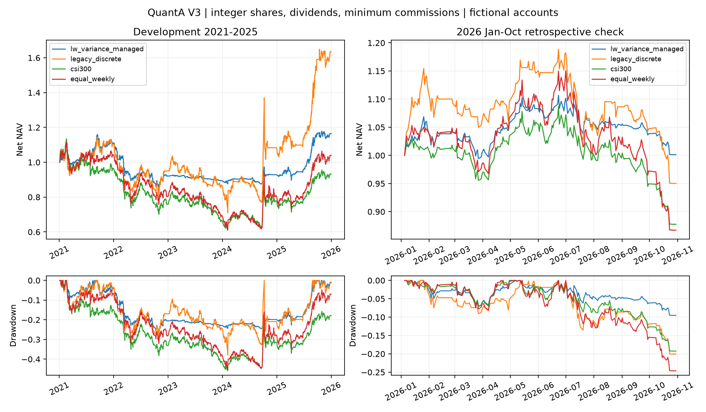

## V10时钟实验：固定预测五组错峰改善亏损，仍未达到收益目标

不重新训练，预先固定五组各20%初始资金的错峰方案。预算随盈亏漂移，按合并后的外部权重变动计费；全部五个单相位公开，不选相位赢家。

| 2022–2024，20bp/边，同一V9预测 | 净夏普 | 累计净收益 | 最大回撤 |
|---|---:|---:|---:|
| 原phase0 | -0.210 | -14.66% | -40.32% |
| 固定五组错峰 | -0.080 | -8.02% | -34.34% |

IC保持0.0430；时钟没有提升模型IC。年换手基本不降，跨组净额节费接近零。结果仅说明这段已见历史上亏损减少，净夏普未达>1、模拟盘未启动。原始年报采集已归档8家公司×2年共16份，其中2份6字段及官方公告日期完成核对；其余仍待逐字段验收，未混入冻结输入。

[实验报告](reports/v10_clock/REPORT.md) · [事先冻结协议](docs/V10_CLOCK_PROTOCOL.md) · [全部相位与费用](reports/v10_clock/evaluation/summary.csv) · [独立复核](docs/V10_CLOCK_REPRODUCE.md)

## 优化准备：先修复数据与目标定义，尚未重新训练

已复查V9实际交易时钟：全日最高预测组H5超额均值约+5.09bp，实际调仓子集约−4.14bp；该差异仅为诊断，未挑选最佳相位或回测新策略。准备了固定五组错峰、收益口径与净额约束。

原始年报已打通1份、核对3个字段；公告时间及历史版本链仍待核验，事实未入训练库。2025/2026在既有实验中已被使用，不会作为新盲测。完整数据、历史成分和股票现金账本仍未就绪；V9收益门槛未通过，模拟盘未启动。

[准备报告](reports/prep_v10/REPORT.md) · [原因与下一步计划](docs/V10_PREPARATION_PLAN.md) · [准备状态](reports/prep_v10/READINESS.json) · [复核](docs/V10_PREPARATION_REPRODUCE.md)

## V9：公开量化方法核查与经济因子修正，仍未通过收益门槛

核查Robert Carver、Artur Sepp及Stefan Jansen的公开实现，完成估值量纲、六个月选模、过去十二个月逐期收益校准和H20持有消融；未复制外部策略收益。固定原数据、58股、H5主IC与每边20bp费用。

| 2022–2024回顾性评价，周频缓冲 | H5 RankIC | 半年折达标 | 净夏普 | 累计净收益 |
|---|---:|---:|---:|---:|
| V7精确匹配对照 | 0.0339 | 5/6 | −0.053 | −7.17% |
| V9预封存economic_h5 | 0.0430 | 5/6 | −0.210 | −14.66% |

两者预测覆盖均100%。IC点估计提高，但配对增量区间跨0；净夏普反而更差，不能宣称优化成功。全部十五项模型/持仓消融保留，未按后段更换候选。模拟盘未启动。

深查发现当前财务表UPDATE_DATE较原公告滞后中位数365天，按防泄漏规则使用的报表期年龄中位数460天；年度ROE缺失约77%。加入估值代理、年龄与缺失处理不等于修复了原始披露版本。独立Baostock来源探查因网络接收错误阻断，未混入任何拟合输入。

[完整报告](reports/v9/REPORT.md) · [公开作者核查](docs/PRACTITIONER_GITHUB_REVIEW.md) · [冻结协议](docs/V9_PROTOCOL.md) · [候选封存](reports/v9/champion_seal.json) · [独立复现](docs/V9_REPRODUCE.md)

## V8：收益幅度、现金与风险配置，降低损失但未改善净夏普

完成三段时序隔离、未参与训练的收益校准、成本与风险约束配置，以及趋势/波动率消融。2020–2021开发后预先封存net_edge；2022–2024仍为已知历史的回顾性评价。

| 后段，20bp/边，同一V8预测 | 净夏普 | 累计净收益 | 最大回撤 | 平均仓位 |
|---|---:|---:|---:|---:|
| 匹配缓冲对照 | −0.087 | −6.66% | −24.26% | 83.4% |
| 封存net_edge | −0.188 | −1.53% | −4.17% | 6.8% |

底层RankIC=0.0252，但有效覆盖仅83.75%、半年折达标50%；收益预测R²=−0.00399。短选模窗口使2022H1三组可靠性同时归零；约89%的信号日最高预测H5收益低于40bp新仓往返费门槛。现金减少了亏损，却未创造收益优势，财务门槛未过，模拟盘未启动。

原等权对照错误继承了平信号现金门控；原记录保留，另公开不依赖α强弱的修正基准。修正未改变封存政策、选优或主要结果。全部负结果公开。

[实验报告](reports/v8/REPORT.md) · [冻结协议](docs/V8_PROTOCOL.md) · [候选封存](reports/v8/champion_seal.json) · [独立复现](docs/V8_REPRODUCE.md)

## V7：底层方法与Kaggle迁移，IC门槛部分达到，收益门槛未过

固定七个对照，检验单窗口翻向、四块验证、可靠性收缩、长训练历史、财务H20目标、市场上下文与小型排名树。查阅Kaggle作者公开实现，独立适配时序验证/市场聚合/多期限思路，未把比赛分数当夏普。

开发后预先封存long_history，再运行2022–2024后段回顾性检查。58股，新来源只取日期/标题，禁用生成摘要，名义30/40/30不变。

| 同一后段、20bp/边、缓冲持仓 | RankIC | 六折≥0.02 | 净夏普 | 累计净收益 |
|---|---:|---:|---:|---:|
| 旧式匹配对照 | 0.0368 | 100% | −0.009 | −4.16% |
| 预封存长历史方案 | 0.0339 | 83.3% | −0.053 | −7.17% |
| Kaggle启发排名树 | 0.0063 | 50% | −0.415 | −24.99% |

封存方案IC区间[0.0084,0.0594]，IC部分过预设门槛，但未胜过旧对照、净夏普未达>1。相同持仓毛收益归因夏普也只有0.227，说明不仅是费用问题：排序分数与可交易净收益/总体仓位存在错配。零费归因不参与选模或准入。

以上为分数份额/后复权收益筛查，未认证完整PIT或真实撮合，**模拟盘未启动**。所有七方法与负结果保留，未事后换冠军。

[完整报告与精进方向](reports/v7/REPORT.md) · [Kaggle方法核查](docs/KAGGLE_METHOD_REVIEW.md) · [冻结协议](docs/V7_PROTOCOL.md) · [候选封存](reports/v7/champion_seal.json) · [复现](docs/V7_REPRODUCE.md)

## V6：GitHub历史来源已接入，首次融合与自主优化未显示可靠增量

核查8个开源仓库，实际采用CMIN-CN历史新闻，与原股票池核对得到58只共同股票、433,482条去重标题。另立30/40/30历史新闻替代配置，保留旧V5严格可得性规则。当前财务与日期型新闻只能做出版/更新日重建的回顾性研究，未认证完整PIT。

2020首次融合RankIC **0.0037**，价量单组0.0068，新闻组−0.0043。依据首轮结果，公开封存新闻实体/文本编码方向后，才运行2021对照：

| 2021同协议 | 融合RankIC | 20bp/边净夏普* |
|---|---:|---:|
| 原方案 | 0.0038 | 0.271 |
| 仅实体过滤 | 0.0028 | 0.277 |
| 实体过滤+TF-IDF | −0.0038 | −0.069 |

*分数份额/后复权收益筛查，非可执行现金账本。配对IC区间跨零，未证实增量；2021也是回顾性复核，未达到稳定IC≥0.02/净夏普>1，模拟盘未启动。首轮、负结果和所有三臂均保留。

[完整结果与下一步](reports/v6/REPORT.md) · [开源来源benchmark](docs/OPEN_SOURCE_DATA_BENCHMARK.md) · [首轮协议](docs/V6_PROTOCOL.md) · [自主改进封存](docs/V6_IMPROVEMENT_DECISION.md) · [复现](docs/V6_REPRODUCE.md)

## 异构数据融合框架：30%基本面 / 40%价量 / 30%另类

已实现双时间/修订特征库、显式实体映射、独立组模型、过去OOF分数校准和固定加权贡献。缺组时拦截，不把缺失的30%自动分给其余信号。

实际接通60股基本面六类指标（60股当前向量完整）、新闻、Polymarket只读行情及卫星STAC目录；X访问尚未配置，卫星尚无像素经济特征，预测市场尚缺股票/行业映射。**采集成功不等于α有效：当前无融合收益结果，模拟盘未启动。**

[框架/API与使用](docs/HETEROGENEOUS_FUSION.md) · [实测接入报告](reports/fusion/REPORT.md) · [配置](configs/fusion.json)

## V4：AKShare价量管道已跑通，稳定性与夏普门槛未通过

60只预先固定的长期上市A股，184,117行原始日线，27个价量因子；2021–2026共12个半年滚动窗口，训练/验证边界清除H=5重叠标签。全部区间为回顾性开发，存续样本存在选择偏差。

| 方法 | 平均OOF RankIC | 日ICIR | ≥0.02折比例 | 20bp/边净夏普* |
|---|---:|---:|---:|---:|
| Ridge | 0.0374 | 0.160 | 58.3% | 0.120 |
| ElasticNet | 0.0371 | 0.148 | 50.0% | 0.128 |
| LightGBM | 0.0146 | 0.070 | 33.3% | −0.442 |
| GP-Ridge | 0.0348 | 0.150 | 58.3% | 0.099 |
| X思路辅助重排 | 0.0202 | 0.091 | 50.0% | −0.462 |

*净夏普来自连续OOF分数份额/供应商后复权收益筛查，非可执行现金账本。平均IC>0.02没有转化为足够稳定的信号或净夏普>1；**模拟准入blocked，发送订单0**。没有通过改切分、删年或降低门槛制造合格结果。

LightGBM采用验证早停；GP仅在训练挖公式，比较同日配对增量IC；本轮未同时扩大到Transformer。AKShare新闻已实际前向采集，发布/首次观察双时间控制，未虚构历史舆情回测。X辅助臂是独立结构适配，不是新版Phoenix完整复现。

[完整结果](reports/v4/REPORT.md) · [原因与下一步](reports/v4/DIAGNOSTICS.md) · [固定协议](docs/V4_PROTOCOL.md) · [复现](docs/V4_REPRODUCE.md) · [X与舆情](docs/V4_X_SENTIMENT.md)

正式拟合源提交：`726783f7ba6d7c96fcece51484f9d1cbe779d27b`。数据版本、候选、早停轮数、公式、随机种子和checkpoints指纹均有记录。公开审计重算418,700行OOF预测对应的7,020个日IC统计及18条成本曲线；本地快照可重放全部预测和收益筛查。旧V1–V3报告保留。

## V3：论文指导的风险与成交改进，尚未发现可靠新α

检索并审查8篇相关论文，加入连续凸组合优化、Ledoit-Wolf协方差收缩、固定均值收缩、成本惩罚、部分调仓和保守逆方差缩放；保留等权与旧式匹配控制。文献也包含波动管理效果不稳定的反面证据。

[文献取舍](docs/V3_LITERATURE.md) · [冻结协议](docs/V3_PROTOCOL.md) · [完整结果](reports/v3/REPORT.md) · [消融与诊断](reports/v3/DIAGNOSTICS.md)

V3按原始报价与分红/拆分事件递推输入，增加登记权益、应收股息、支付日、整手、最低佣金、滞后一日定量订单、容量与价格档位。报价历史版本和精确公告时间仍未认证，不能称为完整PIT数据或真实撮合。

2026-01-01至2026-10-30，虚拟100万元、佣金2bp/最低5元、滑点3bp并向不利价格档位取整：

| 同一预测与账本 | 累计收益 | 净夏普 | 最大回撤 | 年换手 |
|---|---:|---:|---:|---:|
| 预封存方差管理方案 | +0.13% | 0.073 | −9.53% | 13.6 |
| V2式匹配离散控制 | −4.99% | −0.237 | −20.06% | 35.7 |

**预设检验未通过**：三项超额收益区间仍跨零；2026预测R²为−0.076。改善主要表现为风险和换手降低，不能据此声称稳定α。此期为新增回顾性检查，公司行动和少量公开报价信息此前可见，不是前瞻盲测。现金与无风险收益取0。



正式源提交：[a740f45](https://github.com/4v01/QuantA/commit/a740f453764e317fc0b6a592d84ed0206b56a328)；新行情下载前封存：[1864b74](https://github.com/4v01/QuantA/commit/1864b74e5b67c2cfb5d132fe0fc4d766c25ca73f)。

## 审计与复现

6个最终Ridge预测拟合、18个预测候选、342条政策验证路径，396个账本场景全部保留。12个检查点、114条选中预测器的验证账本和396条场景账本可重放。公开日收益可以重算462行统计；原始价格、逐单价格与本地参数不上传公开Git。

```bash
python -m pip install -e . pytest
python -m pytest -q
python -m alphacontextlab.v3.audit
# 以下需要归档data/和outputs/：
python -m alphacontextlab.v3.audit --local-replay
```

[复现指南](docs/V3_REPRODUCE.md)解释公开算术审计、缓存重放、冻结源复训与新数据版本边界。35项协议/账本/证据保护测试通过；V1/V2归档195个文件保持原样。

年度折资金独立重置，全部方法在窗口结束前5个持有区间计划退出，仍计算完整日历。拼接年化不是实际连续账户业绩，2026也不是全年。真实盘口、公告时点档案和更广资产域仍需后续验证。

## 历史版本保持原样

- **V2**：[报告](reports/v2/REPORT.md)、[诊断](reports/v2/DIAGNOSTICS.md)、[协议](docs/V2_PROTOCOL.md)。有界因子演化、研究记忆及X式多目标排序；验证冠军仍为Ridge。2025净夏普2.160，但确认未通过。V3变更了输入/收益权益定义和交易账本，不能把新旧曲线直接拼接成改善。
- **V1**：[报告](reports/v1/REPORT.md)、[诊断](reports/v1/DIAGNOSTICS.md)、[协议](PROTOCOL.md)。LSTM平均净夏普−0.351，Engram式记忆−0.905，未支持记忆增益。

V2参考 [CogAlpha](https://arxiv.org/abs/2511.18850v4)、[XALPHA](https://arxiv.org/abs/2607.08332v3)与[X公开代码](https://github.com/xai-org/x-algorithm/tree/3b6919f87532e57063bb3f1e85c2f509323b513e)的研究/候选/打分/过滤思路；V1参考[DeepSeek Engram](https://github.com/deepseek-ai/Engram/tree/fb7f84a21f91223715394a33a1dc24bbfb7f788e)。均为小规模独立适配，没有复现完整LLM/代理/生产系统，未使用缺失的Level-2或社交数据。
