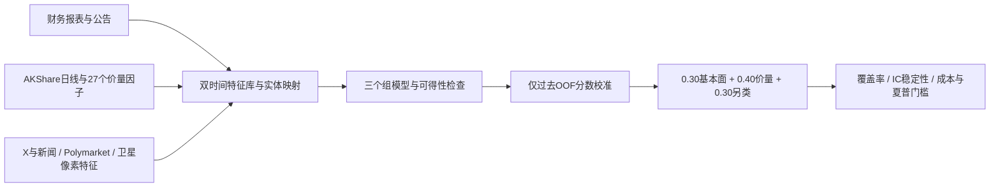

# 30%基本面 / 40%短周期价量 / 30%另类数据融合框架

比例解释为**标准化组预测信号的固定权重**，不是字段数量、训练样本数量或资金仓位比例。配置为configs/fusion.json；更改比例或另类子来源必须成为可追溯的新配置，不能在缺数据时自动改权重。



## 数据契约

每个Observation必须有source/entity/feature、event_at（经济事实或观测时间）、published_at、first_seen_at、数值与单位、observation_key、revision、source_ref。可得时间取三者最大值；财报期末不等于公告日，当期快照也不等于历史首次发布版本。公告仅有日期时保守记到当地日终；财务表UPDATE_DATE也约束可得时间。新采集的旧财报不会倒灌到旧回测。

FeatureStore按决策时刻取数，按观测周期处理修订，旧周期的迟到修订不替换新周期。按来源设置有效期，过期/缺失/坏质量不填0。新闻可按窗口聚合，不把同秒发布的不同文章合并。快照文件不能覆盖。

宏观事件/预测市场/厂址必须有EntityLink，包含标的、关系生效日、首次观察时间与证据。没有映射就不向全股票池广播。坐标附近有卫星图不能证明属于某上市公司。

## 三组信号

| 组 | 初始输入与模型接口 | 权重 |
|---|---|---:|
| 基本面 | ROE、营收/利润同比、资产负债率、EPS、每股净资产；LinearGroupModel的Ridge/ElasticNet基线 | 30% |
| 短周期价量 | 复用V4的价量因子、滚动模型与GroupSignal输出契约；不得把现时快照冒充旧日PIT行情 | 40% |
| 另类 | 新闻、X、Polymarket、卫星特征，经来源内训练标准化与子模型；默认四类各占组内25% | 30% |

银行与一般企业的负债指标、累计报表与单季度量不可直接视为同口径；后续需行业中性化、报告期/TTM处理与缺失模式检查。当前基本面采集只是原始特征，不是已经验证的30%收益贡献。

build_vector只从可得且已映射的观察构建特征；LinearGroupModel拒绝未到期标签、未来特征和缺失值，生成带训练标签截止、模型状态哈希和数据指纹的GroupSignal。已有价量LightGBM等生产者可实现同一契约，不必替换成线性模型。

FixedWeightFusion只在过去OOF分数上拟合每组均值/标准差，且校准标签必须在校准截止前可得；每组z分数固定裁剪±3后按30/40/30相加，保留逐组贡献。不会让原始数值尺度较大的组占据所有权重。

三组任一缺失、另类任一配置来源缺失、来源/模型证据不足、未来特征、训练标签越界时：status=blocked，score=null。不会输出“只有70%数据”的全量融合分数，也不偷偷把另类30%改成价量权重。

## 实际接入与边界

- [AKShare](https://akshare.akfamily.xyz/data/stock/stock.html)：stock_financial_analysis_indicator_em提供报表期、公告/更新日期和财务字段。采集当前完整表并保存哈希/首次观察，不认证历史修订链。
- [Polymarket官方接口](https://docs.polymarket.com/)：只读Gamma `/markets/keyset`发现公开市场和当前隐含概率；实际响应markets字段已核对。市场创建日不是当前价格的产生时间。没有调用下单、钱包或付费接口；概率不是因果α，映射与历史赔率档案尚缺。
- [公开Earth Search STAC](https://earth-search.aws.element84.com/v1)：实际查询Sentinel-2目录。云量/目录数量只作为数据质量/检索元数据，**不作为经济活动因子**。后续需原始像素、云掩膜、厂址核验和时间序列校准。import_satellite_features仅接受有场景/处理时间/厂址证据的NDVI、夜光、车辆计数或SAR测量。
- [X官方API](https://docs.x.com/x-api/introduction)：需要授权访问。本环境未配置X数据凭证，未尝试付费请求；提供授权导出的导入器，必须有实体映射与情绪特征来源。没有把新闻接口冒充X数据，也没有将推荐源码仓库误当帖子数据源。
- 新闻：复用真实AKShare前向缓存，情绪词计数是透明代理；发布与首次观察双时间约束，不伪造历史舆情增益。

## 使用

```bash
python -m pip install -e '.[v4]' pytest
python -m pytest tests/test_fusion.py -q
# 默认三个基本面标的，加公开市场/卫星目录及已有新闻缓存
python -m alphacontextlab.fusion.collect
# 当前固定60股池的基本面快照：
python -m alphacontextlab.fusion.collect --all-symbols --root data/fusion/full_current_new
```

正式采集要求源码和配置已提交且工作树干净。输出acquisition.json逐源状态与features.jsonl。网络失败单独记录；未接通不记作有效来源。源代码提交、配置与快照SHA256保留。导入X/卫星测量使用adapters.import_x_export / import_satellite_features，随后建立有证据的EntityLink。

组模型与校准器的最小可运行契约见tests/test_fusion.py：包括无未来数据、修订处理、实体映射、缺失不改权重和精确30/40/30。测试夹具是合成的正确性检查，不是金融收益实验。

## 评估与准入

后续统一日期/股票池/成本做价量单组、价量+基本面、价量+另类、完整30/40/30消融；缺组实验是单独声明的配置，不能在完整实验内事后切换。比较同日配对ΔIC/ICIR、覆盖率、成本后的组合表现及区块区间。将最早共同可得日期作为新试验起点，数据历史不足时不虚构长回测。

当前框架和采集成功**没有产生新的IC/夏普结果**。V4信号稳定性/净夏普>1尚未过关；新增三组数据也未形成可校准OOF集合，模拟盘继续blocked。先积累可核验历史或前向档案，再进行冻结的融合训练与未来纸面验证。

公开采集审计：`python -m alphacontextlab.fusion.audit`。持有本地快照时：`python -m alphacontextlab.fusion.audit --local data/fusion/v5_current`，核对逐表/特征库哈希、证券身份与首次可见时间；不加载外部pickle。
