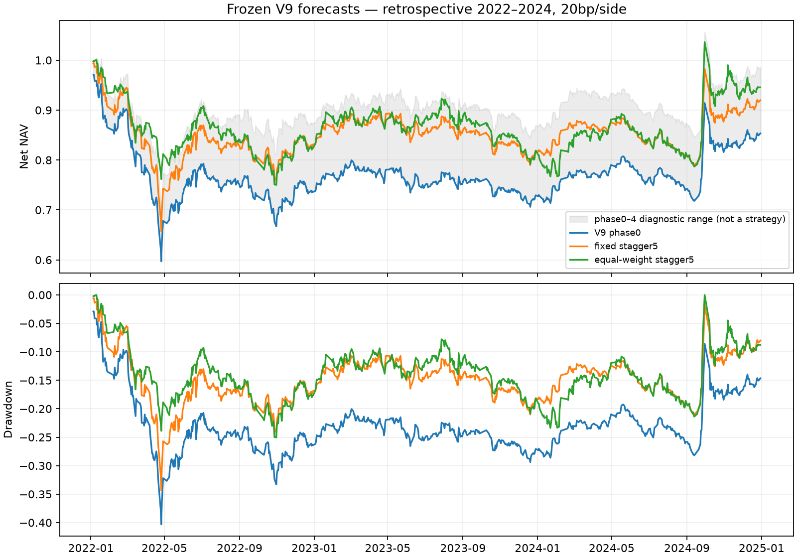

# 固定V9预测的五组错峰实验

没有重新训练或改动融合权重。主方案在任何本轮结果计算前公开固定为economic_h5/stagger5；全部五个单相位只是诊断，未选择相位赢家。2020–2021和2022–2024均是已见历史，不是新的盲测。

## 主结果

每边20bp，2022–2024：原phase0净夏普 **-0.210**、累计净收益 **-14.66%**；五组错峰净夏普 **-0.080**、累计净收益 **-8.02%**。累计结果差+6.64个百分点。等权错峰基准净夏普-0.026、累计-5.45%。

财务门槛 **False**，原因`['net_sharpe_not_above_1']`。H5 IC仍是原预测的0.0430，覆盖100.0%、半年折达标83.3%，**时钟没有提升模型IC**。模拟盘未启动、订单0。

| 固定时钟 | 开发净夏普 | 后段净夏普 | 后段累计净收益 | 后段最大回撤 | 后段年换手 |
|---|---:|---:|---:|---:|---:|
| phase0 | 1.361 | -0.210 | -14.66% | -40.32% | 17.06 |
| phase1 | 1.051 | -0.129 | -10.31% | -32.88% | 17.06 |
| phase2 | 1.113 | -0.110 | -9.64% | -33.68% | 16.77 |
| phase3 | 1.102 | 0.061 | -1.38% | -31.55% | 17.58 |
| phase4 | 1.132 | 0.003 | -4.11% | -33.61% | 17.08 |
| stagger5（预先固定主方案） | 1.173 | -0.080 | -8.02% | -34.34% | 17.12 |

所有相位、两个固定预测对照、独立等权与10/20/30bp路径均公开。没有用后段最好相位替换主方案。主结果包含首周逐组建仓；事先规定的启动五会话后次窗口中，phase0/错峰净夏普分别为-0.109/-0.028，不取代主结果。

## 改善与局限

本段已见历史上，错峰减轻了单一调仓时钟的影响，但距离净夏普>1仍远。主方案平均仓位99.7%；年换手17.12对原方案17.06，没有明显节费。合计净额相抵换手为1.18655085757e-15；每天通常仅一组调仓，本轮不把持仓时钟变化说成跨组净额节费。

主方案夏普的20会话区块条件区间为[-1.1949127650639813, 1.025178687470107]；与phase0配对日收益差区间为[-9.1145613209315e-05, 0.0003043147514464246]。未对整个既往研究的多重试验做校正，不宣称独立发现稳定α。相同持仓零费毛夏普为0.116，完整归因见attribution.json。

## 资金与费用核验

五组各从20%基金资金的现金开始，每天只调对应组。组预算随自身盈亏漂移，不能每天重置；基金只按合并目标和旧持仓的净权重变化收费。保存逐日组预算、现金、持仓及总账户，核验资金守恒和终点退出。

费用仍是V9比例份额、收益前按全基金同比例承担的研究筛查，不能解释为真实股票现金账本。phase0在三个费用下必须精确重现V9原路径，全部对照和基准也遵守同一费用规则。没有通过平均五条净值或夏普替代合并账户。

## 原始财报进展（与实验隔离）

已核验2份平安银行2019/2020年报、6个数值，并通过巨潮公告详情POST接口核对证券代码、公告ID、日期和相同文档路径。

固定8家公司×2年的原始全文采集队列已归档16/16份，保留当前获取时间、官方索引和文档指纹；逐字段人工核对仍只完成上述两份六项。下载齐全不等于原始数据验收通过，其余字段、单位、口径与修订差异待核。当前发行人目录仅用来定位公告，不作为历史投资股票池。

2019原文EPS1.54、普通股每股净资产14.07、加权ROE11.30%；2020为1.40、15.16、9.58%。这六项与当前缓存一致，不能推及所有字段均未修订。公告日期按日期精度记录，不把午夜时间戳当成精确发布时刻，实际获取时间保留为当前。

公告接口的大小字段单位及历史原始字节一致性尚未核实，完整修订链仍缺失。因此这些值留在证据暂存区，**未批准进入训练，也未用于本轮冻结输入**。详见filing_progress.json及原始公告元数据快照；不通过NOTICE_DATE批量回填当前财务表。

## 追溯与下一步

两阶段运行来源为 `49106195e1f1af97e1be1e8ec58f5af0b1f6e2ab` / `49106195e1f1af97e1be1e8ec58f5af0b1f6e2ab`。配置逐文件绑定V9预测、市场回放带、IC和原对照路径哈希；所有旧报告按发布前基准核验未改。

时钟修正只解决部分损失，仍需要原始财务版本、历史成分、更广市场状态与收益单位校准。固定幸存者股票池、供应商后复权收益及非可执行账本继续阻断模拟盘。下一步优先扩展数据工程样本并核验完整版本，而非事后挑选单相位或把零费结果作为主成绩。

[事先冻结协议](../../docs/V10_CLOCK_PROTOCOL.md) · [协议指纹](protocol_seal.json) · [复现](../../docs/V10_CLOCK_REPRODUCE.md)

