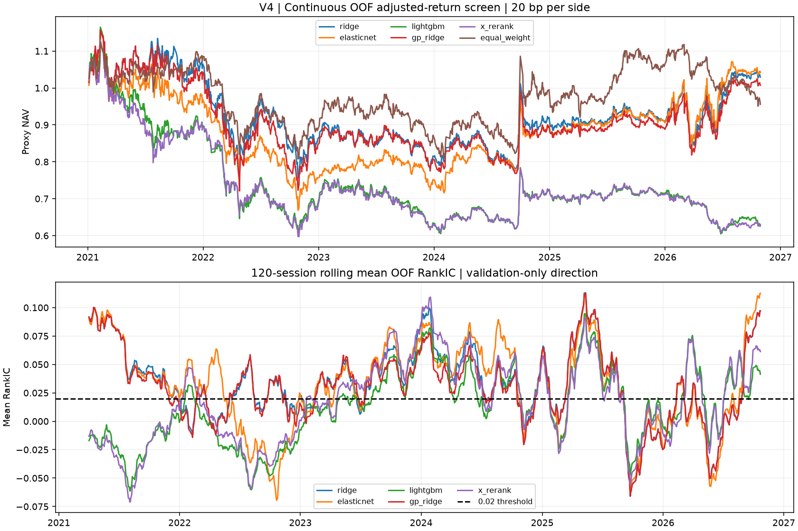

# QuantA V4：AKShare 价量信号与滚动研究

正式拟合源提交：`726783f7ba6d7c96fcece51484f9d1cbe779d27b`。

固定60只长期上市存续A股；2014–2026原始及后复权快照。2021–2026均为回顾性开发，不是新盲测。
每半年：30个月训练、6个月验证，H=5，标签为下个开盘到第6个开盘的供应商后复权收益代理。退出日严格早于切分边界。
27个基础价量因子采用同日截面秩；没有用全样本标准化。缺失日保留，模型行缺因子则排除并计数。
方向与参数只看验证集；线性信号门槛为有向OOF RankIC≥0.02、至少75%折≥0.02、20日区块95%均值区间下界>0。
ICIR=日RankIC均值/样本标准差，不把重叠5日标签按sqrt252放大。

## 信号与增量比较

| 方法 | 平均RankIC | 日ICIR | 达标折比例 | 95%区块区间 | 稳定性门槛 |
|---|---:|---:|---:|---|---|
| ridge | 0.0374 | 0.160 | 58.3% | [0.0132, 0.0628] | 未通过 |
| elasticnet | 0.0371 | 0.148 | 50.0% | [0.0092, 0.0643] | 未通过 |
| lightgbm | 0.0146 | 0.070 | 33.3% | [-0.0067, 0.0380] | 未通过 |
| gp_ridge | 0.0348 | 0.150 | 58.3% | [0.0104, 0.0587] | 未通过 |
| x_rerank | 0.0202 | 0.091 | 50.0% | [-0.0027, 0.0455] | 未通过 |

所有方向均在每折验证确定；不对样本外IC取绝对值，不因某年差而删年。高级方法即使在线性门槛失败时也只作为探索诊断。

| 相对Ridge | 配对ΔRankIC | 95%区块区间 |
|---|---:|---|
| elasticnet | -0.0004 | [-0.0174, 0.0184] |
| lightgbm | -0.0228 | [-0.0441, -0.0003] |
| gp_ridge | -0.0027 | [-0.0061, 0.0001] |
| x_rerank | -0.0173 | [-0.0395, 0.0047] |

## 连续样本外收益筛查

全部OOF信号日连续拼接持仓，跨年不重置资金，5日调仓，前20%等权，只做多；末尾平仓计费。
主要情景为每边20bp的假设总费用，另列10/30bp压力；不是准确历史税费、整手/最低佣金/竞价成交现金账本。
开盘目标权重是分数份额因子组合约定；停牌缺报价以旧价估值，不能把它称为可执行成交。后复权收益不是已认证分红现金总回报。
全样本指全部滚动样本外日期，不是训练集拟合曲线。原始AKShare报价/模型留在本地快照，公开其版本哈希。

| 方法 | 每边成本bp | 净夏普 | 累计收益 | 年化收益 | 最大回撤 | 年换手 |
|---|---:|---:|---:|---:|---:|---:|
| ridge | 10 | 0.358 | 31.82% | 5.07% | -32.63% | 44.2 |
| ridge | 20 | 0.120 | 2.94% | 0.52% | -36.26% | 44.2 |
| ridge | 30 | -0.118 | -19.64% | -3.84% | -42.77% | 44.2 |
| elasticnet | 10 | 0.316 | 24.99% | 4.07% | -37.79% | 32.6 |
| elasticnet | 20 | 0.128 | 4.12% | 0.73% | -42.31% | 32.6 |
| elasticnet | 30 | -0.060 | -13.28% | -2.52% | -46.51% | 32.6 |
| lightgbm | 10 | -0.189 | -21.33% | -4.20% | -43.94% | 40.3 |
| lightgbm | 20 | -0.442 | -37.21% | -7.99% | -48.20% | 40.3 |
| lightgbm | 30 | -0.694 | -49.90% | -11.64% | -57.90% | 40.3 |
| gp_ridge | 10 | 0.339 | 29.11% | 4.68% | -33.42% | 44.4 |
| gp_ridge | 20 | 0.099 | 0.73% | 0.13% | -37.67% | 44.4 |
| gp_ridge | 30 | -0.140 | -21.43% | -4.22% | -43.77% | 44.4 |
| x_rerank | 10 | -0.211 | -21.83% | -4.31% | -42.68% | 38.5 |
| x_rerank | 20 | -0.462 | -36.99% | -7.93% | -47.11% | 38.5 |
| x_rerank | 30 | -0.714 | -49.22% | -11.42% | -55.94% | 38.5 |
| equal_weight | 10 | 0.040 | -3.46% | -0.63% | -27.89% | 1.8 |
| equal_weight | 20 | 0.029 | -4.42% | -0.81% | -28.10% | 1.8 |
| equal_weight | 30 | 0.018 | -5.37% | -0.98% | -28.32% | 1.8 |

## 模拟盘状态

验证IC选定候选：**elasticnet**；状态：**blocked**。

阻断原因：linear_signal_stability_gate_failed, selected_model_signal_gate_failed, net_sharpe_not_above_1, nonpositive_evaluation_year, pit_universe_not_certified, executable_cash_event_ledger_not_certified。

没有发送模拟或真实订单，没有启动常驻交易任务。门槛失败时不得强行标记为进入模拟盘；local paper命令保留可审查的拦截记录。

## X机制与舆情边界

X启发的辅助臂用同一LightGBM分数，增加固定波动/流动性秩惩罚，复用候选→排序→过滤的思路。是独立金融适配，不是移植X原始权重，也没有其用户互动数据。
AKShare新闻只做前向采集，published_at和first_seen_at都必须早于决策时刻。词典情绪只是可解释代理；本轮没有可信历史首次可见档案，未加入历史训练，不伪造历史舆情增益。

## 已知问题与下一步

固定存续股票池有幸存者/人工选择偏差；当期后复权历史会修订；样本内选择和多重试验使漂亮OOF点估计仍有选择偏差。
置信区间是各臂的描述性诊断，不是覆盖整个研究历史的多重检验校正；不能把每半年重新定向当作固定信号方向稳健性。
进入模拟盘前需要历史可得股票池、公司行动及真实可执行账本；先通过信号稳定性与净夏普门槛，再封存未来纸面评估。
完整折参数、早停轮数、GP公式、数据文件SHA256、随机种子和源提交见同目录证据。旧V1/V2/V3报告保留。

## 附加诊断

score_metrics.json保留截面秩目标RMSE/R²，不能与旧收益率标签的R²直接比较；factor_summary.csv为基础因子的原始有向OOF IC，无事后翻转，不用于重挑本轮模型。

[原因诊断与下一步](DIAGNOSTICS.md) · [新旧X源码边界与舆情](../../docs/V4_X_SENTIMENT.md)
