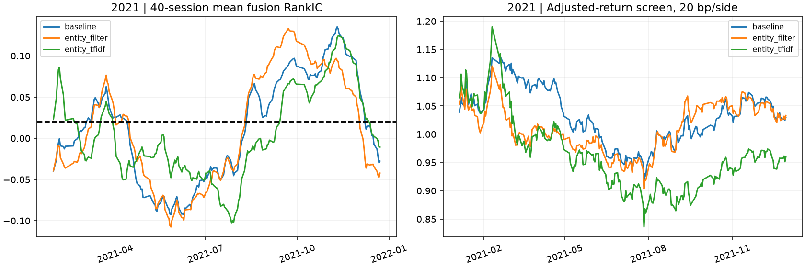

# V6：GitHub历史来源、首次融合IC与自主优化复核

本轮实际采用CMIN-CN原始历史新闻：58只共同股票、433,482条去重标题，固定作者仓库提交。检索核查8个开源项目，区分数据集与仅有采集器的工具。
来源、配置和旧V5严格框架均保留。V6是按新闻日期与财报公告/更新日重建的**回顾性研究，不是严格PIT或前瞻盲测**；另类30%明确改为历史中国公司新闻，基本面30%/价量40%不变。

## 首次融合：2020年

| 组 | RankIC | 日ICIR |
|---|---:|---:|
| alternative | -0.0043 | -0.030 |
| fundamental | -0.0026 | -0.012 |
| fusion | 0.0037 | 0.021 |
| price_volume | 0.0068 | 0.039 |

各均值区间跨零；融合IC0.0037未超过价量0.0068。基本面也跨期反向，不能将全部弱表现归因于新闻。

## 根据首轮IC选定的方向

新闻组IC为负、与价量预测相关近零，原始公司新闻文件又含其它公司主题条目。因此封存一个方向：实体关联过滤与字符文本表示，并以仅过滤作为消融。
2020原结果和改进计划在提交`8c50a43f2e3b97bda49f7305cf50385900427c55`公开后，才运行2021三臂；价格与基本面预测在三臂逐行一致，费用、样本和权重相同。
2021行情已见于V4，因此本轮是后续回顾性复核，不把它称为绝对未见的盲测。

## 同一2021样本下的结果

| 新闻编码 | 新闻组IC | 融合IC | 融合日ICIR | 融合净夏普* | 累计收益* |
|---|---:|---:|---:|---:|---:|
| 原方案 | 0.0083 | 0.0038 | 0.021 | 0.271 | 2.99% |
| 仅实体过滤 | 0.0111 | 0.0028 | 0.015 | 0.277 | 3.31% |
| 实体过滤+TF-IDF | -0.0013 | -0.0038 | -0.020 | -0.069 | -3.98% |

*每边20bp分数份额/供应商后复权收益筛查，非可执行现金账本。每个阶段独立初始资金，阶段内半年间不重置，不把2020和2021拼成实盘账户。10/30bp及全部组、等权结果见各case目录。

| 相对2021原融合 | 配对ΔIC | 95%区块区间 |
|---|---:|---|
| 仅实体过滤 | -0.0010 | [-0.0184, 0.0186] |
| 实体过滤+TF-IDF | -0.0076 | [-0.0432, 0.0253] |

**改进未获支持。** 过滤使新闻组点估计稍升，但融合未升；字符TF-IDF的两项IC和收益筛查均退化。区间仍宽，不将最高点估计挑作确认成功。

## 为什么仍低，以及下一步方向

- 组内预测有效性弱、符号随验证窗口变化；同样方差的标准化分数不等于同样可靠。固定30/40/30会让弱组也提供足量噪声。后续优先研究基于多个过去验证窗口的可靠性校准，并明确记录其对有效贡献的影响，不偷偷改权重。
- 基本面是慢变量，却预测H5收益，且当前表的部分更新晚于原公告；六字段含YTD、行业差异。后续先比较披露时点、报告期对齐、行业处理与不同预测期限，再给复杂模型更多容量。
- 完整公司名过滤会漏掉简称，词典难表达语义，字符文本可能学到公司/风格噪声。下一步需要可审查的历史别名与事件类型；不能在看到2021收益后手挑别名把本轮结果改好。
- 新闻档案只到2021，股票池为存续交集；新数据源解决了获取问题，没有消除样本选择、修订链和历史时刻的不确定性。更长数据必须另立版本，不能把缺档日填成中性消息。

这些是后续待验证方向，**本轮没有声称实现稳定IC≥0.02或净夏普>1**。没有启动模拟盘、没有订单。

## 复核材料

[来源benchmark](../../docs/OPEN_SOURCE_DATA_BENCHMARK.md) · [冻结协议](../../docs/V6_PROTOCOL.md) · [首轮IC](pilot/REPORT.md) · [改进封存](../../configs/v6_improvement.json) · [复现说明](../../docs/V6_REPRODUCE.md)

每个case公开逐股票预测、逐日IC、参数/符号选择、校准、数据指纹、源提交与检查点哈希。原始新闻、财务/报价与自有模型在本地快照。旧V1–V5和首轮报告不覆盖。

