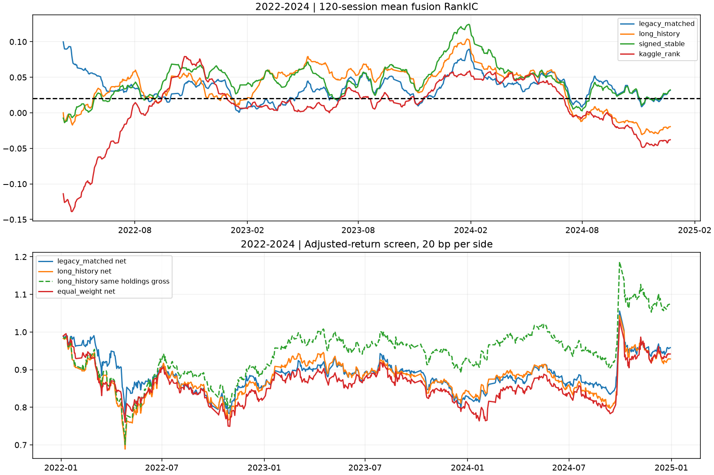

# QuantA V7：底层方法修正与Kaggle公开思路迁移

2026-11-16（北京时间）。2020–2021为已知开发资料；候选封存后才运行2022–2024后段。价格以前已见、当前财务和历史新闻版本未完整PIT认证，因此后段仍是回顾性检查。
新增FinMultiTime来源仅取非空title与datetime，不用生成摘要；58股、后段43,231条去重标题，旧CMIN/报价/财务版本和58股交集不变。来源变化会带来分布漂移，所有后段方法用同一份数据。

## 实际改造

七个预先固定对照检验单窗口翻向、弱组等幅放大、训练历史过窄、财务目标期限以及市场上下文/排序目标。全部主要IC仍为H5，名义融合30/40/30；可靠性会降低有效贡献，其系数全部公开，不重分配。
Kaggle作者代码启发了时序切分、市场截面聚合和多期限目标。小型LambdaRank是本项目独立排名改造，不声称复制比赛冠军。盘口、匿名特征、提前可得响应标签与排行榜选模没有移植。

## 开发与封存

开发平均IC最高且覆盖合格的候选为 **long_history**；其开发IC=0.0384，四折通过0.02比例=100.0%。封存文件和开发结果在GitHub推送后才运行后段，未看后段更换候选。
开发指标不作为后段成功证明。旧式匹配对照在本轮也使用H20 purge，所以不可把V7旧式数值当V6原协议重跑。

## 2022–2024同协议结果

| 方法 | RankIC | 日ICIR | 半年折≥0.02 | 净夏普：周频 | 净夏普：缓冲 | 缓冲累计收益 |
|---|---:|---:|---:|---:|---:|---:|
| legacy_matched | 0.0368 | 0.196 | 100.0% | -0.461 | -0.009 | -4.16% |
| signed_stable | 0.0446 | 0.236 | 100.0% | -0.415 | -0.044 | -5.92% |
| reliable | 0.0419 | 0.221 | 66.7% | -0.500 | -0.103 | -9.04% |
| long_history | 0.0339 | 0.188 | 83.3% | -0.481 | -0.053 | -7.17% |
| aligned_fund | 0.0295 | 0.164 | 66.7% | -0.512 | -0.168 | -12.65% |
| kaggle_context | 0.0352 | 0.196 | 50.0% | -0.539 | -0.284 | -18.19% |
| kaggle_rank | 0.0063 | 0.038 | 50.0% | -0.512 | -0.415 | -24.99% |

每边20bp为固定主费用，另有10/30bp。全部IC覆盖100%；其他费用/暴露/换手见case曲线。分数份额/供应商后复权收益筛查不是可执行股数现金账户，未认证盘口、税费和公司行动；不称实盘。

## 对目标的判定

封存候选IC=0.0339，95%区块区间[0.0084, 0.0594]，六折有五折达到0.02。**IC部分满足本轮预设门槛，净夏普未达到>1。** 财务门槛结论：False；原因：net_sharpe_not_above_1。
旧式匹配对照在后段也达到IC门槛，均值甚至略高于封存候选；不能把开发改善或时期变化说成已证明后段算法胜出。signed_stable等消融后段点估计较高，但它们未被预先选为候选，不能看完结果替换冠军。

| 相对旧式匹配对照 | 配对ΔIC | 95%区块区间 |
|---|---:|---|
| signed_stable | 0.0078 | [-0.0109, 0.0268] |
| reliable | 0.0052 | [-0.0081, 0.0183] |
| long_history | -0.0029 | [-0.0268, 0.0215] |
| aligned_fund | -0.0073 | [-0.0332, 0.0195] |
| kaggle_context | -0.0016 | [-0.0299, 0.0249] |
| kaggle_rank | -0.0305 | [-0.0638, -0.0000] |

## 为什么IC合格仍未盈利

封存方案缓冲年换手25.5；同持仓毛收益归因累计7.46%，扣固定主费用后累计-7.17%，净最大回撤-31.14%。这个零费归因不用于选模/准入，也不是可用的成本设置。全池等权净累计-5.85%。
同持仓零费归因的夏普也只有0.227，所以问题不只是费用，毛信号与持仓规则本身也没有达到夏普1。降低假设费率不会被当成解决方案。
IC衡量相对排序，并不保证全仓只多的Top20%具有足够绝对收益；市场方向、尾部收益、持有期和交易成本都影响利润。缓冲大幅减少换手，但仍未创造足以覆盖费用的优势。决策日IC另存，不能把全部日频IC当作每个交易日都实际变现。
可靠性缩小的是组信号贡献；随后Top20%排序仍会充分投资，故较低分数幅度不自动降低总仓位。这是当前预测—组合接口的具体错配，需要未来把收益幅度、成本与现金决策连起来，而不是继续只优化名次。
Kaggle启发的上下文/排名树也没有提供可靠胜出证据；竞赛相关性或NDCG不能替代成本后的组合目标。财务近似年化不是TTM，慢变量H20训练也未普遍改善后段；全部负结果保留。

## 下一步更值得精进的方向

1. 从“秩分数等幅混合”进一步转向过去验证期可校准的预期收益幅度，检验预期收益是否超过往返成本与不确定性，再决定是否交易。这个方向需要新封存试验，不在已用后段重调来报成功。
2. 把选股、持有期限与成本目标统一；比较低换手持仓/交易缓冲时同时约束风险和暴露，不靠降低20bp费用或只展示牛市。
3. 分离市场方向与相对选股的贡献，加入现金基线与等风险对照；当前充分投资的只多组合不是纯α。
4. 补历史披露版本、行业/报表期口径、实体别名和更长新闻档案，先核验信息增量，再增加网络容量。
以上为基于证据的待验证方向，未声称已经解决。**模拟盘未启动，订单0。** 即便部分IC门槛通过，数据/真实成交结构仍有阻断。

## 证据与复现

[Kaggle方法核查](../../docs/KAGGLE_METHOD_REVIEW.md) · [冻结协议](../../docs/V7_PROTOCOL.md) · [候选封存](champion_seal.json) · [复现](../../docs/V7_REPRODUCE.md)

全部七方法、两种持仓政策、三种费用、每折参数/方向/可靠性/模型指纹、逐股票预测和逐日路径保留。区块区间为条件诊断，不是覆盖整个研究历史的多重检验校正。

