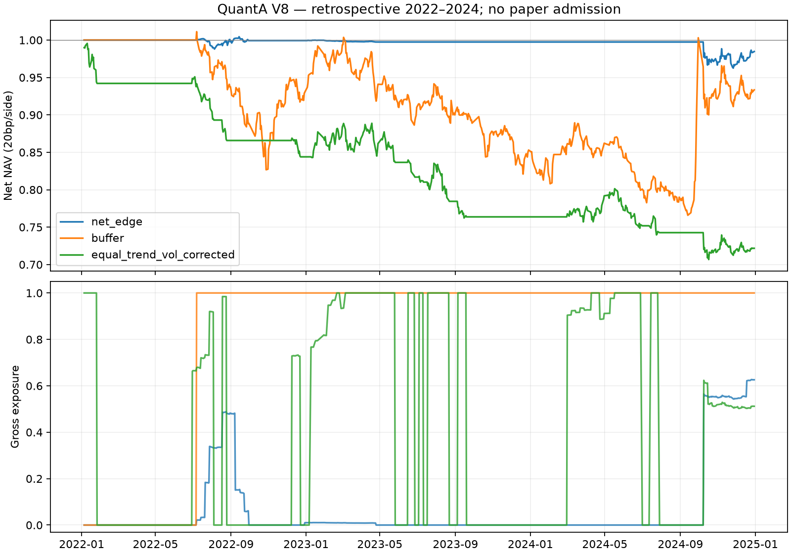

# QuantA V8：收益幅度、成本、现金与风险接口

本轮是沿用已知历史的**回顾性优化**，不是新盲测。2020–2021用于开发选政策；公开封存后运行2022–2024，后段不能换冠军。58股、同一供应商价格/财务/新闻版本、H5目标、30/40/30名义信号权重和每边20bp主费用不变。

## 结论

开发唯一封存政策为 **net_edge**。后段净夏普 **-0.188**、累计净收益 **-1.53%**，预设财务门槛 **False**，失败原因 `['IC_coverage_below_90pct', 'IC_fold_stability_failed', 'net_sharpe_not_above_1']`。模拟盘未启动，订单0。

共同底层信号RankIC **0.0252**，日ICIR 0.159，95%区块区间 [0.0000, 0.0505]，半年折≥0.02比例 50.0%，有效IC覆盖 83.8%。配置器改变持仓和收益，不将控仓解释成提高IC。

## 同数据、同预测、同费用对照

| 政策 | 开发净夏普 | 后段净夏普 | 后段累计净收益 | 最大回撤 | 平均仓位 | 年换手 |
|---|---:|---:|---:|---:|---:|---:|
| buffer | 0.292 | -0.087 | -6.66% | -24.26% | 83.4% | 22.5 |
| vol_buffer | 0.324 | -0.157 | -7.82% | -23.84% | 73.3% | 20.1 |
| trend_vol_buffer | 0.042 | -1.467 | -25.44% | -27.41% | 36.8% | 15.2 |
| net_edge（封存） | 0.549 | -0.188 | -1.53% | -4.17% | 6.8% | 0.8 |
| trend_net_edge | 0.549 | -0.346 | -2.57% | -4.93% | 5.1% | 0.8 |
| equal_trend_vol_corrected | 0.530 | -1.400 | -27.83% | -29.33% | 40.7% | 9.4 |

原缓冲对照后段夏普-0.087；封存政策点估计相差-0.102。同趋势/波动率规则的全池等权基准夏普-1.400。这项基准直接对照trend_vol_buffer；net-edge使用风险惩罚而非相同目标波动，不能声称所有政策风险完全相等。完整逐年及10/20/30bp结果一并保留，不能以后段最好的消融替换封存政策。

**基准修正说明：** 冻结代码的原equal_trend_vol错误地继承了“α分数全平则现金”门控，使基准也受选股信号强弱影响。后段复核发现后保留原18+18条路径、模型与所有候选政策；另在benchmark_correction公开不依赖α强弱的真正全池等权趋势/波动率基准及6条新路径。表格、归因与图只用修正基准；该基准从不参与候选选优，修正未改变候选或财务门槛。新增回归测试证明把所有预测改为零或任意非零值不会影响修正基准。

## 与V7的区别与归因边界

V7封存long_history在后段IC0.0339、净夏普-0.053。本轮为了隔离校准数据，将原6个月验证拆成前3个月选模、后3个月校准，因此底层模型也有变化；V8的buffer才是分离组合改造作用的匹配对照。不能把V8与V7的全部差异归功于配置器。

每折校准期预测来自仅训练至校准期之前的checkpoint，退出日按H20严格purge。最终checkpoint使用评价开始前可得资料。斜率负值归零、上限0.1、固定收缩0.5，不翻向，不用后段校准。市场分量是已知过去60日市场日均收益×5×0.25；120日趋势指标是58股合成代理，不是可交易指数。

收益预测RMSE=0.042443，标准R²=-0.003987，相对零收益预测R²=-0.003953。R²为1-SSE/SST，绝不使用IC²。正的排序关系不保证可预测足够大的绝对收益。

后段89.0%的信号日中，最高预测H5绝对收益仍低于40bp新仓往返费门槛；每日最高预测收益的中位数仅0.09%。这是预测值，不是已实现收益或实盘套利。2022H1三组可靠性同时归零，导致整折融合分数全平、IC不可定义；不是把这些天当作IC=0后隐去。三个月选模窗口叠加四块稳定性收缩降低了覆盖，缩短选模历史是本轮明确的回退。

净优势配置器在固定约束下优化预期H5收益减风险、当期单边换手费和保守预留退出费。最后一项仅进入决策目标，不在模拟中提前重复扣费；路径只扣真实调仓和终点退出费。单股≤10%、总仓位≤100%，无杠杆、无做空、现金收益0。趋势控仓和现金不能被包装为已证明的选股α。

封存政策后段夏普的条件20日区块区间为[-0.8698013177886361, 0.6809842073142692]；相对等权趋势波动基准的日均收益差区间为[9.95569579021641e-05, 0.0007377044649995744]。完整研究历史没有多重试验校正，因此这些区间只用于诊断。相同持仓零费用归因见attribution.json，不用于改主费用或换候选。

## 数值问题与可追溯性

两次开发运行在通用SLSQP线搜索处中断，未选出候选、未运行后段，日志与部分checkpoint保留。只改善尺度仍未解决，随后改成直接求同一凸目标的近端梯度算法；预算乘子二分求解，每次正式配置要求近端梯度残差<1e-10。没有修改收益目标、费用、组合政策或选优规则。病态协方差与可手算最优解测试覆盖该修正。

成功开发来源：`c8db8cbba1f9fd590afb19a7f029a5fe0dbb9084`。
封存及后段来源：`895c7a5a24f140e605a7b69929e42970c33fc65d`。
公开预测、校准期预测、市场回放带、每日持仓、每条费用路径、两套模型指纹、选择边界和参数全部保留。checkpoint二进制另存本地受信复现包，CI只使用无pickle的公开证据。单独基准修正来源为最终报告提交的benchmark.py，不把它说成预先冻结的原始实现。

## 已知问题和后续方向

固定幸存者股票池、2026年获取的现行后复权报价与财务修订链、新闻来源切换、比例复权收益筛查缺乏股数现金撮合认证，仍阻断模拟盘。最大单股上限约束配置时权重，随后价格漂移允许超出；数据中的历史停牌/涨跌停与开盘成交可行性未经认证，不能假定可执行。

本轮把弱信号、成本和现金连接起来，但结果仅降低损失与回撤，未改善封存方案的净夏普。下一步先恢复足够长的有符号选模窗口，另用更长、严格逐期生成的历史预测校准收益，避免短窗口硬归零；再检验长持有期的收益幅度能否覆盖成本。还需要独立时期/历史成分股与披露版本、真实成交账本；这些方向尚未验证，不根据同一后段搜索趋势参数来制造夏普>1。

[冻结协议](../../docs/V8_PROTOCOL.md) · [复现说明](../../docs/V8_REPRODUCE.md) · [候选封存](champion_seal.json)

