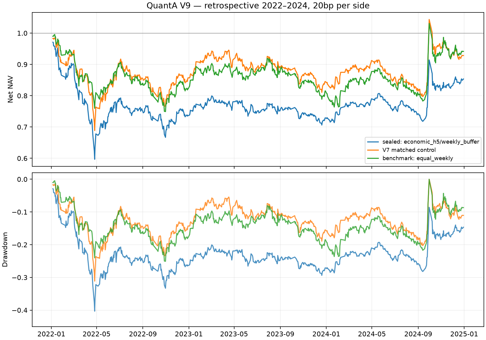

# QuantA V9：公开量化作者核查、经济因子与逐期校准

2026-11-16北京时间。所有区间已见，属于回顾性研究；开发2020–2021，公开封存后才运行2022–2024。原58股、原数据快照与每边20bp主费用保持一致，不用更换后段赢家、降低费用或换主指标达标。

## 结论

预先封存 **economic_h5/weekly_buffer**，后段净夏普 **-0.210**、累计净收益 **-14.66%**、最大回撤 **-40.32%**。财务门槛 **False**，原因 `['net_sharpe_not_above_1']`。数据/成交结构阻断仍存在，**模拟盘未启动，订单0**。

封存模型H5 RankIC=0.0430，95%区块区间[0.0115, 0.0747]，有效覆盖100.0%，半年折达标比例83.3%。匹配控制的后段净夏普-0.053，封存方案点估计差-0.157。点估计改善不自动代表统计显著或可执行盈利。

## 核查了哪些公开来源

[Robert Carver](https://github.com/robcarver17)的[履历](https://www.systematicmoney.org/bio)支持其AHL从业背景；其系统现位于[pst-group/pysystemtrade](https://github.com/pst-group/pysystemtrade)。阅读预测缩放与缓冲实现，本轮采用预测/仓位分离及慢频成本对照，没有复制GPL代码或复刻其期货系统。

[Artur Sepp](https://github.com/ArturSepp)的[QuantInvestStrats](https://github.com/ArturSepp/QuantInvestStrats)提供风险、绩效和基准归因实现；本轮核查相关文档，采用明确频率、条件区间及收益/风险分开报告。并不将分析工具说成可直接移植的α。

[Stefan Jansen](https://github.com/stefan-jansen/machine-learning-for-trading)属于技术作者/咨询背景，核查其价值、质量、动量与多期限公司特征案例，采用因子量纲和期限一致性思路。没有复制其市场、长短交易或比赛收益。

[完整核查与身份依据](../../docs/PRACTITIONER_GITHUB_REVIEW.md)及practitioner_sources.json保留三个固定revision、许可和阅读文件哈希；外部代码未被复制/执行。额外数据来源探查使用单独隔离的Baostock客户端，不属于上述项目代码移植，也没有进入V9拟合输入。

## 当前方法的局限与实际修正

1. **短验证窗口导致硬归零。** 恢复6个月有符号选模；将可靠性硬门控作为单独消融。原V7 matched_control的逐股预测与周频缓冲收益路径均由审计校验，不靠换弱基线。
2. **因子量纲。** 从每股EPS/BPS水平改为价格相对估值代理，另加年度ROE、现金盈利比、报表年龄及长期动量/风险特征。TTM EPS仅使用当日已知的YTD、上年全年、上年同期分量，缺失保持缺失；股份口径/拆并股匹配未经认证，不称完整PIT。
3. **校准占用选模历史。** 用2019起严格逐期预测形成过去12个月已成熟H20标签校准集，保证每条校准预测来自当时已经冻结的模型；不再牺牲完整选模窗口，也不对负斜率翻向。
4. **H5优势与成本错配。** 保留H5主指标，增加H20训练、20交易日持有和H20风险/收益配置消融。没有将次指标H20冒充主指标。

四个学习模型仍用30/40/30名义信号权重。classic_value_quality是明确独立的50%基本面/50%价量基准，不是静默更改融合权重。经济特征以一组加入，未隔离到单一特征的因果贡献；任何收益差不能单独归功于EPS/价格或某位作者。

## 更底层的数据问题

原财务快照中，公告2018–2024记录的UPDATE_DATE相对NOTICE_DATE滞后中位数 **365天**，超过180天比例 **100.0%**。当前输入面板可得报表的报告期年龄中位数 **460天**，P90为515天。年度ROE缺失 **76.6%**。

这说明“当前API历史表”不等于“当时披露版本”。本轮加入年龄特征和缺失指示，但**没有修复原始版本缺失**，也没有把修订后数值按更早公告回填。PIT与股份口径仍是数据阻断。可选参考[Qlib PIT采集器](https://github.com/microsoft/qlib/tree/main/scripts/data_collector/pit)探查Baostock历史成分/财务来源；本环境匿名登录发生网络接收错误，回执data_source_probe.json为blocked，没有导入任何新数据。即使可连通，pubDate仍需与原始公告/修订历史核验。

UPDATE_DATE滞后本身不证明每个字段都改过；它表示当前表不足以认证更早的逐字段可得值。

## 后段信号与可解释性

| 模型 | H5 IC | H5覆盖 | 半年折≥0.02 | H20 IC（次指标） | H20超额收益R² |
|---|---:|---:|---:|---:|---:|
| matched_control | 0.0339 | 100.0% | 83.3% | 0.0396 | -0.00013 |
| full_window | 0.0339 | 100.0% | 83.3% | 0.0387 | -0.00001 |
| economic_h5 | 0.0430 | 100.0% | 83.3% | 0.0470 | -0.00054 |
| economic_h20 | 0.0428 | 100.0% | 83.3% | 0.0503 | -0.00071 |
| classic_value_quality | 0.0477 | 100.0% | 83.3% | 0.0699 | -0.00095 |

R²按H20截面去均值收益的1-SSE/SST计算，明确不是绝对收益R²、不是IC²。每条预测保留两期限标签、模型指纹及校准窗口。

## 同费用全部组合结果

| 模型/政策 | 开发净夏普 | 后段净夏普 | 后段累计净收益 | 最大回撤 | 年换手 | 平均仓位 |
|---|---:|---:|---:|---:|---:|---:|
| matched_control/weekly_buffer | 1.046 | -0.053 | -7.17% | -31.14% | 25.5 | 100.0% |
| matched_control/slow_buffer | 0.894 | 0.249 | 8.81% | -26.86% | 11.1 | 100.0% |
| matched_control/slow_net_edge | nan | nan | 0.00% | 0.00% | 0.0 | 0.0% |
| full_window/weekly_buffer | 0.834 | -0.269 | -16.48% | -32.80% | 20.2 | 100.0% |
| full_window/slow_buffer | 0.905 | -0.204 | -14.43% | -31.06% | 7.6 | 100.0% |
| full_window/slow_net_edge | nan | 0.647 | 6.11% | -4.17% | 0.4 | 3.8% |
| economic_h5/weekly_buffer（封存） | 1.361 | -0.210 | -14.66% | -40.32% | 17.1 | 100.0% |
| economic_h5/slow_buffer | 1.285 | -0.077 | -8.59% | -39.76% | 7.6 | 100.0% |
| economic_h5/slow_net_edge | -0.078 | 0.708 | 2.48% | -1.31% | 0.2 | 2.2% |
| economic_h20/weekly_buffer | 1.252 | -0.108 | -9.45% | -40.14% | 13.5 | 100.0% |
| economic_h20/slow_buffer | 1.519 | -0.195 | -13.33% | -36.41% | 7.2 | 100.0% |
| economic_h20/slow_net_edge | 0.443 | 0.657 | 4.47% | -2.80% | 0.2 | 3.9% |
| classic_value_quality/weekly_buffer | 0.394 | 0.355 | 11.14% | -14.97% | 4.6 | 100.0% |
| classic_value_quality/slow_buffer | 0.509 | 0.414 | 13.46% | -15.11% | 2.8 | 100.0% |
| classic_value_quality/slow_net_edge | nan | 0.293 | 0.51% | -0.85% | 0.1 | 1.0% |
| equal_weight/equal_weekly | 0.984 | -0.034 | -5.85% | -25.08% | 3.9 | 100.0% |
| equal_weight/equal_slow | 1.037 | -0.055 | -6.80% | -24.39% | 2.2 | 100.0% |
| equal_weight/equal_slow_vol | 0.949 | -0.150 | -9.99% | -25.07% | 2.1 | 89.8% |

所有数字主费用为20bp/边；10/30bp全路径、逐年、持仓与费用均公开。空仓零波动夏普为undefined，不填成0或成功。等权基准独立于α分数强弱；slow_net_edge采用风险惩罚，并非与equal_slow_vol完全同风险，基准差不可直接解释为纯α。

封存政策后段夏普条件20日区块区间为[-1.417029741297992, 0.9546360026493319]；相对所列基准的日均收益差区间为[-0.0006649079739182124, 0.00030192679625100566]。全部研究历史未做多重试验校正，不据此单独声称显著。相同持仓零费用归因不参与选模或准入。

## 进一步归因：IC为何没有变成收益

以下是看完评价后的诊断，不用于重选候选、构造新交易规则或声称因果贡献。

| 分支 | 开发H5 IC | 后段H5 IC |
|---|---:|---:|
| fundamental | 0.0331 | 0.0142 |
| price_volume | 0.0449 | 0.0456 |
| alternative | 0.0104 | 0.0139 |
| fusion | 0.0487 | 0.0430 |

基本面分支信号弱化，价量分支保持，融合未超过价量的IC点估计；不能从此直接推断移除某组就会改善净夏普。按可得日期计，每股每自然日标题强度从5.11降到0.69，无标题的股票自然日比例从22.8%升到74.1%。覆盖漂移确实存在，但新闻分支IC没有同时下降，故不能把亏损简单归因于新闻来源切换。

| 预测分位（5最高） | 平均H5毛收益/bp | 相对同日全池超额/bp | 超额95%区间/bp |
|---|---:|---:|---|
| 1 | -9.63 | -10.31 | [-26.22, 7.17] |
| 2 | -1.19 | -1.88 | [-13.73, 8.51] |
| 3 | 2.04 | 1.36 | [-7.69, 10.57] |
| 4 | 5.94 | 5.26 | [-3.96, 14.49] |
| 5 | 5.77 | 5.09 | [-13.99, 22.34] |

最高分组的平均毛收益幅度很小，最高两组也没有清晰单调优势。全截面正IC可以同时反映识别落后者，而只多策略必须能买到足够强的赢家。分位统计使用全部有效预测日、有重叠H5标签；它不是缓冲持仓结果，不能直接乘频率年化或当可交易α。20bp/边新仓往返费用约40bp，缓冲能降低实际成本，但不能凭这些微弱均值证明覆盖费用。

相同封存持仓即使零费，后段毛收益夏普也只有-0.024。这是收益结构问题，不只是费率。58股的后段收益相关矩阵描述性参与率约7.06、第一主成分解释35.4%，说明股票数量不等于独立风险维度；该参与率不是有效试验数，也不能直接当夏普上限。

下一步应先获得历史成分/原始披露版本、覆盖更多市场状态的逐期预测，再围绕“可交易赢家的收益幅度与风险”校准各分支，而非让每组标准化后天然同幅。还需用跨市场状态的开发区间检验政策选择：本轮2020–2021开发改善未迁移到后段，不能继续只凭该开发期夏普选复杂度。上述方向尚未验证；后段较好的低仓位消融也未被提升为新冠军。

## 工程修复、追溯与已知问题

首次开发缺预测日误清仓，使原对照路径偏离V7；在任何V9候选封存与后段运行前修复为全模型/基准统一保持原仓位，完整重跑。原始尝试和未封存候选保留在development_attempt1_correction.json及本地证据包；不是隐藏失败或修改费用/模型选优。新增审计要求V7对照路径数值一致。

开发来源 `818e2f15a68a8dd3852beebc13445e84065891ee`；封存/后段来源 `77547da8ad4e4b655b6d9d296faa2361bfc09c7b`。公开预测含2019预热，指标与开发选优仅2020–2021。60组checkpoint与逐期标签成熟规则可重放。

固定幸存者股票池、财务修订和股份口径、历史新闻来源切换、比例后复权收益缺股数现金撮合认证仍存在。市场方向、行业集中、只有58股的横截面宽度与重复用历史选优，仍限制泛化判断。任何财务门槛结论都不自动解除这些阻断。

[冻结协议](../../docs/V9_PROTOCOL.md) · [候选封存](champion_seal.json) · [复现](../../docs/V9_REPRODUCE.md)

